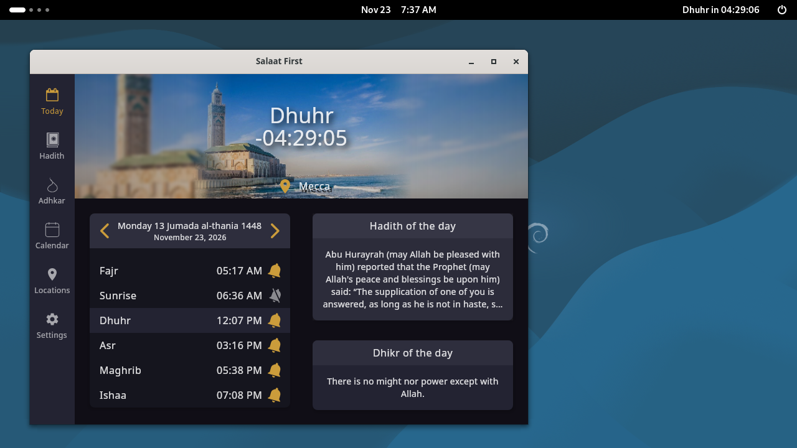
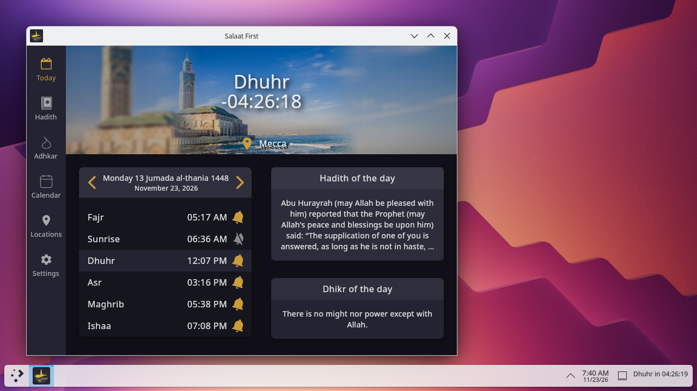
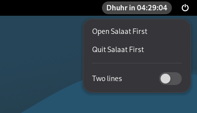
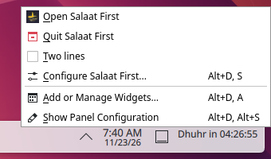

# Salaat First for Linux

An unofficial way to run the [Salaat First](https://apps.microsoft.com/detail/9pksnkt5dfsp) prayer times app on Linux.

The Windows version of Salaat First is a Java app, so it can run on Linux too. `port.sh` downloads that release from the Microsoft Store and builds a normal package for your distribution. It adds the Linux libraries the app needs, a Java runtime and a panel widget. This repository contains no part of the app itself; everything is downloaded and built on your own computer.

This project is not affiliated with the developer of Salaat First. The packages you build contain the app, so please don't share them.





## What you need

- A 64-bit Intel or AMD computer (x86_64). ARM is not supported.
- Debian, Ubuntu, Fedora or Arch Linux, or a distribution based on one of them. Other distributions can use the AppImage (see [Without automatic updates](#without-automatic-updates)).
- About 1 GB of free space in `/var/tmp` while it builds.

Install the tools the script uses:

| Distribution | Command |
|---|---|
| Debian, Ubuntu | `sudo apt install git curl python3 openssl` |
| Fedora | `sudo dnf install git curl python3 openssl rpm-build createrepo_c` |
| Arch | `sudo pacman -S --needed git curl python openssl base-devel` |

## Install

```sh
git clone https://github.com/sickl8/salaat_first_linux.git
cd salaat_first_linux
sudo ./port.sh -i
```

This takes a few minutes and downloads about 180 MB. It builds the package into a repository on your computer and tells your package manager about it. Then install the app the usual way:

| Distribution | Command |
|---|---|
| Debian, Ubuntu | `sudo apt update && sudo apt install salaat-first` |
| Fedora | `sudo dnf install salaat-first` |
| Arch | `sudo pacman -Syu salaat-first` |

Salaat First is now in your applications menu. From the next login it starts hidden in the background, so prayer notifications and the adhan still play when its window is closed.

### The panel widget

On Windows, Salaat First runs in the background with an icon in the notification area (the tray). The icon's menu has **Show/Hide**, **Open settings** and **Quit**. On Windows 10, the app's Start menu tile also showed the day's prayer times. GNOME has no tray for apps, so this port adds a panel widget for GNOME and KDE Plasma that does both jobs.

To turn it on, log out and back in once after installing, then:

- **GNOME:** run `gnome-extensions enable salaat-first@local`. Click the countdown in the top bar to open its menu.
- **KDE Plasma 6:** right-click the panel, choose **Add Widgets…** and add **Salaat First**. Right-click the countdown to open its menu.

| | GNOME | KDE Plasma |
|---|---|---|
| Menu |  |  |
| Two lines |  |  |

What the widget does in place of the tray:

| On Windows | With the widget |
|---|---|
| The Start menu tile with the day's times | The countdown to the next prayer, for example "Dhuhr in 04:29:06". For 30 minutes after a prayer it counts up instead: "Dhuhr 00:12:30 ago". |
| **Show/Hide** in the tray menu | **Open Salaat First** shows the window. To hide it, close the window: the app keeps running and still notifies you. |
| **Open settings** in the tray menu | Open the app and click **Settings**. |
| **Quit** in the tray menu | **Quit Salaat First**. As on Windows, there are no notifications or adhan until you open the app again or log back in. It doesn't ask for confirmation. |

**Two lines** shows the time until the next prayer (−) and the time since the last one (+).

The widget follows the app's language (English, Arabic, French or Spanish) and, in Arabic, its choice of digits (1,2,3 or ١,٢,٣). Like the app, it shows Jumua in place of Dhuhr on Fridays.

The widget gets the day's times from the app, which saves them every 5 minutes, so it shows `…` until the app has run once. On KDE the app may also put its own icon in the system tray, but in our tests that icon didn't respond to clicks, so use the widget instead.

### Notifications

Prayer notifications are your desktop's own notifications. The app calls this **Native desktop notifications**, a setting under **Settings** > **Advanced**, and this port turns it on by default. The adhan notification stays on screen and plays the adhan until you click **Stop** or close the notification. Clicking a notification opens the app.

As on Windows, native notifications only play the adhans that come with the app, not your own sound files. To get the app's own notification popups back, turn off **Native desktop notifications**.

## Updates

Updates come in with your normal system updates.

Once a day, a background job (`salaat-first-update.timer`) checks the Microsoft Store for a new release. If there is one, it builds the new package into your local repository. It downloads only the parts of the app that changed, usually a few megabytes. Your next system update installs it, whether you use the Software or Discover app, `sudo apt upgrade`, `sudo dnf upgrade` or `sudo pacman -Syu`.

To check for a new release right away:

```sh
sudo systemctl start salaat-first-update.service
journalctl -u salaat-first-update.service    # what it did
```

To get a newer version of this script, run this in your clone. The background job uses its own copy, which `-i` refreshes.

```sh
git pull
sudo ./port.sh -i
```

## If the download fails

The script finds the download through [store.rg-adguard.net](https://store.rg-adguard.net), which sometimes refuses requests. If it does, download the file by hand:

1. Open store.rg-adguard.net and paste `https://apps.microsoft.com/detail/9pksnkt5dfsp`. Leave the two menus at **URL (link)** and **RP**, and search.
2. Download the newest file whose name ends in `.msixbundle` (about 260 MB).
3. Give it to the script: `sudo ./port.sh -i ~/Downloads/<that file>.msixbundle`

Later updates still download only the parts that changed.

## Without automatic updates

To build a package file and install it yourself, run the script without `-i` (and without `sudo`):

```sh
./port.sh                  # a package for your distribution, in the current folder
./port.sh -f appimage      # an AppImage, for any distribution
```

Install the file with `sudo apt install ./salaat-first_*.deb`, `sudo dnf install ./salaat-first-*.rpm` or `sudo pacman -U salaat-first-*.pkg.tar.zst`. To update, run the script again and install the new file. The AppImage doesn't include the panel widget and doesn't start at login.

## Is the download safe?

The Microsoft Store serves its files over plain HTTP. Before using anything it downloads, the script checks Microsoft's signature on the package against Microsoft's root certificate. The signature covers every file of the app, and it must belong to Salaat First's publisher. A changed or corrupted download stops the build. store.rg-adguard.net only provides the download link, so the script doesn't need to trust it.

The Java runtime (Eclipse Temurin, from Adoptium) and the Linux libraries (from Maven Central) are downloaded over HTTPS and checked against their published checksums.

The local repository isn't signed. Your package manager can trust it because only root and the update job's own user (`salaat-first`) can write to it.

## Uninstall

Remove the app:

```sh
sudo apt remove salaat-first       # or: sudo dnf remove salaat-first / sudo pacman -R salaat-first
```

`-i` also set up a few things for updates. Remove them with:

```sh
sudo systemctl disable --now salaat-first-update.timer
sudo rm /etc/systemd/system/salaat-first-update.service /etc/systemd/system/salaat-first-update.timer
sudo systemctl daemon-reload
sudo rm -f /etc/apt/sources.list.d/salaat-first.list /etc/yum.repos.d/salaat-first.repo
sudo rm -r /var/lib/salaat-first   # the local repository, about 350 MB
sudo userdel salaat-first
```

On Arch, also delete the `[salaat-first]` section at the end of `/etc/pacman.conf`.

Your settings and data stay in `~/.config/SalaatFirst`, `~/.local/share/SalaatFirst` and `~/.cache/SalaatFirst`. Delete those too for a clean removal.

## For developers

- `port.sh` builds the packages and sets up the repository. Its header lists every option. It also patches two classes in the app's jars: one makes native notifications the default, and the other makes the custom-tone and adhan settings take their Windows code path. If a release changes those classes, the build skips the patch and the app keeps its own popups.
- `msix-fetch.py` downloads the app and checks its signature. It reuses the blocks a previous build already has.
- `widgets/` holds the GNOME extension and the KDE widget.
- `test/e2e.sh deb|rpm|pacman` tests installing and updating in a container. It needs rootless podman.

## License

The code in this repository is under the [MIT license](LICENSE). Salaat First itself, which the script downloads, is not covered by it.
